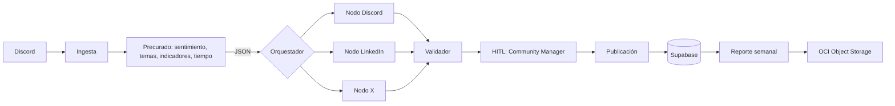

# 📋 Informe de Sprint Review — Sesión del 10 de octubre

## ℹ️ Información General

- **Fecha:** Lunes, 12 de octubre de 2026.
- **Próxima sesión / demo:** Jueves 15 de octubre (meta: presentar el flujo completo ya integrado).
- **Proyecto y equipo:** Simulación No Country — Equipo CommunityLab (Hackathon ONE G10).
- **Fase actual:** Etapa 2 — Orquestación multi-agente, integración backend/frontend y preparación de pruebas y video de demo.
- **Objetivo principal:** Presentar el diseño y avance del **orquestador** (grafo de nodos), definir la estrategia de procesamiento (lote vs. mensaje por mensaje), revisar el stack de modelos y el monitoreo, y organizar el plan de pruebas, el video de demo y los recursos compartidos del equipo.

## 📌 Resumen Ejecutivo

Se presentó el diseño de la **orquestación** del sistema: un grafo (nodos y aristas) que recibe mensajes ya procesados por dos pipelines previos (ingesta de Discord y precurado/análisis), decide a qué canales dirigirlos (Discord, LinkedIn, X), genera el contenido con la voz de marca, lo pasa por un **validador** y por una aprobación humana (**HITL**) del community manager, y finalmente publica, guarda en Supabase y alimenta el reporte que se envía a OCI. El código del orquestador aún no está en `main`; se espera subirlo entre el sábado y el domingo, con lo que se completaría el checklist de requisitos mínimos. Se decidió procesar **un mensaje a la vez** (en lugar de lotes de 5) para controlar el consumo de tokens en los modelos gratuitos y mejorar la calidad por mensaje. También se presentó el stack de modelos (Groq y Gemini, con respaldos), la integración con **LangSmith** para trazabilidad, y se acordó el plan de pruebas y de video de cara a la demo del jueves.

## 💬 Temas Clave y Discusiones

### 🧠 Arquitectura de orquestación

- **Entrada del orquestador:** ya no recibe el mensaje crudo de Discord. Recibe un **JSON** que pasó por dos pipelines: la **ingesta** (Alonso) y el **precurado** (Fernando), que añade sentimiento, temas, indicadores y datos de tiempo/etiquetas especiales.
- **Decisión de ruteo:** el orquestador lee el contexto y los parámetros del JSON y determina a qué nodos enviar el mensaje. Ejemplo: un mensaje de **logro** (alguien consiguió un puesto y reconoce que un curso le ayudó) puede ir a **LinkedIn**, a **X** y también a **Discord** como notificación de que el curso está dando resultados.
- **Nodos de copywriting:** cada nodo adapta el contenido a la marca de la empresa ficticia y al formato de su red. La parte de copywriting (trabajo de Tania) ya está lista.
- **Validador:** confirma que el resultado cumple las condiciones de curado antes de pasar a revisión humana.
- **HITL (Human-in-the-Loop):** el community manager aprueba, modifica o **pospone** (por ejemplo, si el contenido es repetitivo respecto a lo ya publicado).
- **Cierre del flujo:** lo aprobado se publica, se guarda en **Supabase** y desde ahí se arma el **reporte** (automático, manual o por ciclo) que se sube a **OCI**. Esta última conexión (Supabase → reporte → OCI) es lo que falta por cablear.
- **Requisito de formatos:** se cumple el mínimo de dos activos de marketing por mensaje (p. ej., post para X y LinkedIn, o X y Discord); el orquestador puede dirigir un mismo mensaje a varios nodos (hasta cuatro destinos).
- **Contenido por canal:** LinkedIn y X tienden a recibir contenido destacado (logros); Discord, contenido más conversacional (p. ej., preguntas frecuentes). Un mismo mensaje puede alimentar varios canales con propósitos distintos (reforzar información y destacar el logro).

### ⚙️ Estrategia de procesamiento: lote vs. mensaje por mensaje
- **Planteamiento inicial:** lotes de 20 mensajes; se discutió dividirlos en **lotes de 5**, que el orquestador evaluaría una vez y repartiría a los nodos.
- **Problema:** cada lote genera una alta demanda de **tokens de salida** (estimado de ~1,500–2,000 por lote de 5), lo que presiona los límites de los modelos gratuitos y puede devolver JSON mal estructurado o contenido menos coherente con la marca.
- **Además:** en la práctica el community manager revisa **uno por uno**, no cinco a la vez.
- **Decisión:** procesar **mensaje por mensaje**: entra un mensaje → orquestador → nodo(s) → validador → HITL → publicación → siguiente. Da más control del consumo de tokens, mejor calidad por mensaje y facilita la evaluación humana.

### 🤖 Stack de modelos y respaldos
- Se eligió una combinación de modelos de **Groq** y **Gemini** (capas gratuitas), pensada para un **MVP/entorno de demostración** (no para alto consumo).
- Criterio de selección: se probaron los modelos disponibles y se descartaron los que no responden, están fuera de servicio, tienen cuotas muy bajas (≈10 solicitudes/min) o son inestables. En Groq cambian a menudo los modelos disponibles, por lo que se priorizaron los **más estables**.
- Asignación: un modelo más robusto para **orquestador y validador**, modelos tipo *flash-lite* en los nodos de contenido ("los de batalla") y **un respaldo configurado por nodo** que entra si el modelo principal no responde.
- Se mencionó que modelos como Gemma resultaron poco confiables: al fallar consumen sus propios tokens de salida.
- Los resultados de las pruebas (requests por minuto/día, tokens de salida) sustentaron la selección.

### 🔎 Observabilidad: LangSmith
- Se integró **LangSmith** sobre el flujo (corriendo hoy en Colab) para ver trazas, errores y ejecuciones exitosas a nivel de **grafo y nodo**.
- Permite identificar dónde se detuvo el grafo y el motivo concreto del fallo, lo que acelera el debugging durante la fase de pruebas.

### 🗄️ Persistencia y plataforma
- **Supabase** como base de datos: ya respalda el flujo y el equipo (Fernando y Tania) lo está integrando en sus procesos; quedan por adaptar detalles menores.
- Pendiente: lectura de lo aprobado desde Supabase para generar el reporte semanal y subirlo a **OCI**.

### 🌐 Redes sociales para la demo
- **X:** ya existe cuenta propia, aún sin probar por completo.
- **LinkedIn:** se solicitó una página de empresa para la marca ficticia, pero es probable que la rechacen por las restricciones de LinkedIn a empresas ficticias. **Plan B:** publicar desde un perfil personal, lo cual deberá notarse en el video.
- **Discord:** el servidor ya cuenta con los **canales divididos** según el tipo de interacción.

### 🧪 Datos de prueba y carga de mensajes
- La ingesta carga lotes de **100 mensajes**; actualmente hay **52** ya en la base de datos (no cuentan como mensajes nuevos).
- **Acuerdo:** primero procesar los mensajes existentes; cuando el flujo completo esté cerrado y se tenga un panorama claro, se cargan más para probar robustez con más datos y mensajes reales en vivo.
- Se solicitó avisar antes de cargar muchos mensajes al canal para actualizar la ingesta.

### 🧑‍🔧 Apoyo técnico (testing y unificación)
- Cristian ofreció apoyar con **QA/testing**, revisión del código una vez subida la última rama (la del orquestador) y con la **unificación frontend–backend** junto con Andrés si se complica.

### 🎬 Videos
- **Video de demo (No Country):** se grabará cuando el flujo corra con fluidez; un integrante actuará como CM aprobando tres mensajes para publicarse. Fecha tentativa: fin de semana si las pruebas salen bien, o el lunes.
- **Opción para agilizar:** grabar una pantalla del flujo de principio a fin, pasar el video a una IA para extraer los procesos y generar un guion, convertirlo a voz y combinar audio y video. Se mencionó **NotebookLM** como herramienta posible (usada en el curso de Alura).
- **Video de Alura (1:30 min):** presentación formal del perfil, respondiendo preguntas típicas de entrevista laboral, con indicaciones de dónde subirlo. Hay dudas sobre el plazo: un comunicado apunta a "hasta mañana", pero la cronología lo ubica en la última semana. Se recibió además un correo (con mención a una reunión) que genera dudas de autenticidad; se pidió aclaración al equipo de Alura sin respuesta aún.

### 📁 Recursos compartidos del equipo
- **Cuenta central compartida:** se bloqueó por múltiples intentos de acceso desde varias regiones y **no se pudo recuperar**. Propuesta: crear otra cuenta y compartir carpetas y recursos, **sin compartir la contraseña** (solo accesos a los recursos). Queda a decisión del equipo.
- **Drive:** se usará como repositorio común (minutas, documentos); se compartió con permisos de edición y se eliminará al terminar el hackatón.
- **Minutas/Sprint:** se solicitó una carpeta compartida (y un Excel editable) para reconstruir el registro de minutas y sprints que se tenía antes.

## 🤝 Acuerdos y Decisiones

- 🔁 **Procesamiento unitario:** el flujo opera mensaje por mensaje (no por lotes) para controlar tokens y calidad.
- 🧭 **Orquestador como ruteador contextual:** decide los destinos con base en el JSON precurado (sentimiento, temas, indicadores).
- 🧑‍⚖️ **HITL obligatorio antes de publicar:** el CM aprueba, modifica o pospone.
- 🤖 **Modelos con respaldo por nodo**, priorizando estabilidad sobre potencia para un MVP.
- 📊 **LangSmith** como herramienta de trazabilidad durante pruebas.
- 📥 **Datos de prueba:** trabajar primero con los mensajes existentes antes de cargar más.
- 🔗 **LinkedIn:** si se rechaza la página de empresa, se publicará desde perfil personal.
- 📅 **Calendario:** flujo completo idealmente listo el miércoles/jueves; fin de semana para pruebas y correcciones; video después.
- 📁 **Cuenta compartida:** crear una nueva sin compartir contraseñas; Drive como espacio común.

## 🚀 Plan de Acción / Tareas Pendientes

| Tarea / Acción a realizar | Responsable | Contexto o detalles clave |
|---|---|---|
| Terminar y subir a `main` el código del orquestador | Enoc (responsable del orquestador) | Meta: entre sábado y domingo; completa el checklist de requisitos mínimos |
| Conectar Supabase → reporte semanal → OCI | Enoc (responsable del orquestador) | Parte final del flujo, aún pendiente |
| Adaptar detalles pendientes de Supabase en los procesos | Fernando y Tania | Integración ya en curso |
| Completar la segunda etapa del frontend / unificación con el backend | Andrés Martínez | Andrés ya adelantó parte; el resto en una segunda etapa |
| Actualizar ingesta antes de cargar más mensajes al canal | Eduardo Alonso | Hay 52 mensajes en BD; lotes de 100 |
| Procesar los mensajes existentes con el flujo completo y luego ampliar el volumen | Equipo técnico | Para validar el flujo antes de probar con más datos |
| Apoyar con QA y revisión de código tras subir la última rama | Cristian | También apoyo en unificación front–back |
| Probar la cuenta de X y esperar respuesta sobre la página de LinkedIn | Enoc | Plan B: perfil personal |
| Crear nueva cuenta central sin compartir contraseña (o definir alternativa) | Por definir por el equipo | La anterior se bloqueó y no es recuperable |
| Compartir carpeta de Drive con permisos de edición para minutas y sprint | Eduardo Alonso | Se eliminará al finalizar el hackatón |
| Grabar el video de demo y definir método (grabación + guion + voz con IA) | Equipo (por confirmar) | Fecha tentativa: fin de semana o lunes |

---
